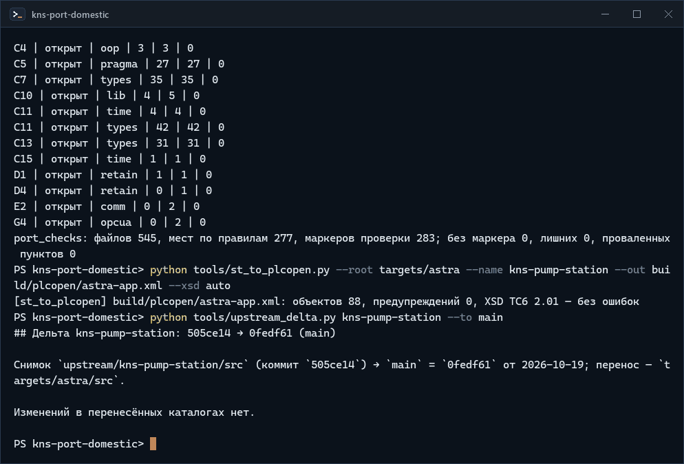
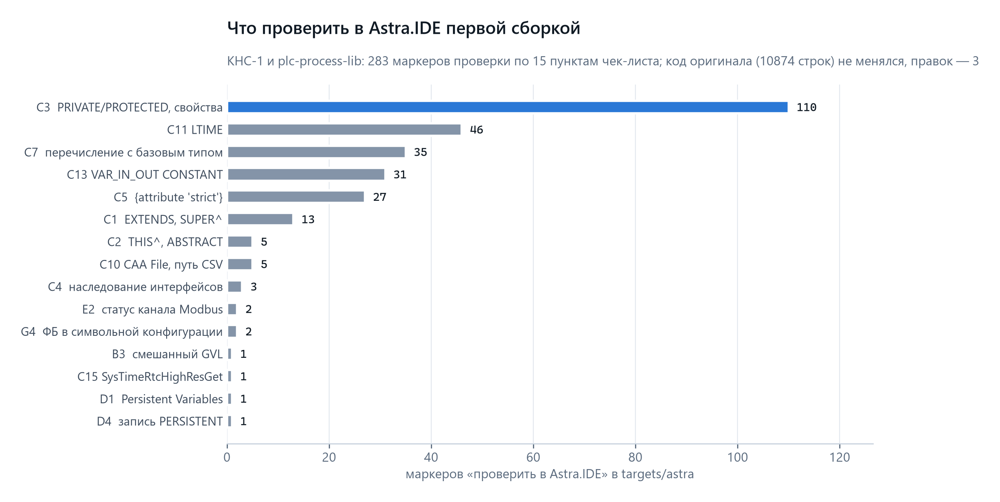
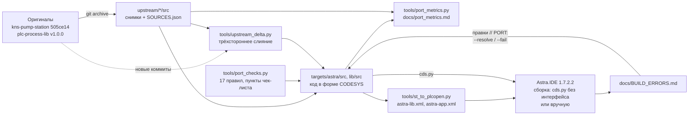

<p align="center">
  <picture>
    <source media="(prefers-color-scheme: dark)" srcset="docs/media/banner-dark.svg">
    <source media="(prefers-color-scheme: light)" srcset="docs/media/banner-light.svg">
    
  </picture>
</p>

<p align="center"><b>Перенос проекта CODESYS V3.5 на отечественную Astra.IDE (ПЛК REGUL) с расчётом цены переноса: что работает как есть, что проверить, что переписать</b></p>

<p align="center">
  <a href="https://github.com/kr0nsch/kns-port-domestic/actions/workflows/ci.yml"></a>
  <a href="LICENSE"></a>
  
  <a href="docs/BUILD_ERRORS.md"></a>
  
  <a href="#тесты-и-качество"></a>
</p>

<p align="center"><a href="#что-это-и-зачем">Что это</a> · <a href="#как-это-выглядит">Как выглядит</a> · <a href="#быстрый-старт">Быстрый старт</a> · <a href="#как-использовать-в-своём-проекте">Свой перенос</a> · <a href="#как-устроено">Как устроено</a> · <a href="#документация">Документация</a> · <a href="#summary-en">Summary (EN)</a></p>

**Перенос флагмана КНС-1 и библиотеки ФБ plc-process-lib из CODESYS 3.5.17.30 в Astra.IDE (РегЛаб,
ПЛК REGUL R500 и его виртуальный ПЛК).** Когда проект на CODESYS нужно перевести на отечественную
среду, обычно непонятно, сколько кода переживёт перенос и что сломается: документация вендора
подтверждает не всё, а пробная сборка в среде — работа на дни. Здесь код подготовлен и собран в
Astra.IDE 1.7.2.2 без ошибок (на ПЛК ещё не запускался), каждое место, которое осталось проверить, помечено
пунктом чек-листа, цена переноса посчитана по маркерам, а повторить оценку на своём проекте можно теми
же инструментами. Для инженеров АСУ ТП и техлидов интеграторов.

## Что это и зачем

Флагман КНС-1 — канализационная насосная станция на CODESYS: три насоса с ПЧ по Modbus RTU, модель
объекта, журнал событий, WebVisu; устройства — из библиотеки plc-process-lib (наследование ФБ,
интерфейсы, свойства). Astra.IDE — OEM-сборка той же линейки CODESYS V3.5 SP17, но её документация
не описывает наследование ФБ, `SUPER^`, `ABSTRACT`, спецификаторы доступа и ещё десяток конструкций, на
которых построен код. Репозиторий переводит этот вопрос из «неизвестно» в список проверок с числом мест.
Первая сборка в Astra.IDE 1.7.2.2 (19.10.2026) ответила на главный вопрос: наследование и вся ООП-часть
компилируются, ошибка нашлась одна — в новом адаптере Modbus ([BUILD_ERRORS.md](docs/BUILD_ERRORS.md)).

**Что даёт:**

- Адаптированный код для Astra.IDE: [`targets/astra/src`](targets/astra/src) (приложение) и
  [`targets/astra/lib/src`](targets/astra/lib/src) (библиотека `PL`), с зафиксированными коммитами
  оригиналов; файлы импорта PLCopen XML собираются одной командой и в CI.
- Маркеры `// PORT: … проверить в Astra.IDE — что (пункт)` у каждой конструкции, которую
  документация РегЛаб не подтверждает: до сборки — 283, после сборки 19.10.2026 — 58 (пункты, подтверждённые
  компиляцией, сняты); пункты — в [чек-листе миграции](docs/migration_checklist.md#9-проверить-вручную),
  факты о среде — 93 штуки со ссылками на документы вендора ([differences.md](docs/differences.md)).
- Цена переноса в строках и маркерах по категориям ([port_metrics.md](docs/port_metrics.md)), которая
  считается заново в CI и после каждой итерации сборки.
- Цикл сборки: сообщения компилятора → [BUILD_ERRORS.md](docs/BUILD_ERRORS.md) → правки с маркерами
  или подтверждение пункта одной командой. Собирать можно без интерфейса среды: `tools/codesys/cds.py`
  работает с Astra.IDE без правок.
- Перенос новых версий флагмана: дельта и трёхстороннее слияние с правками переноса
  (`tools/upstream_delta.py`).

**Для кого.** Инженеры АСУ ТП, которым поручили перевести проект CODESYS на Astra.IDE и нужно назвать
сроки до пробной сборки; техлиды интеграторов, которые оценивают импортозамещение ПЛК; вендоры и
заказчики — как пример того, как переносится реальный проект с ООП.

### Цена переноса

| Показатель | Значение |
|---|---|
| Значимых строк оригинала | 10 874: флагман — 6 453 (коммит `505ce14`), библиотека — 4 421 (тег `v1.0.0`) |
| Без изменений / изменено / переписано | 100 % / 0 % / 0 % — после сборки в Astra.IDE (правка по сборке — в новом объекте) |
| Новый код | 3 объекта, 68 строк: слой Modbus RTU для ПЛК REGUL (`[comm]`) |
| Маркеров проверки | 58 по 7 пунктам (до сборки — 283 по 15). C1–C4 (наследование, 131 маркер) подтверждены компиляцией — композиция не понадобилась; больше всего осталось у C11 (`LTIME`, 46: монотонность проверяется на ВПЛК) |
| Итераций сборки до 0 ошибок | 2 (19.10.2026): 8 ошибок → 0, одна правка ([BUILD_ERRORS.md](docs/BUILD_ERRORS.md#сводка)) |
| Трудозатраты, ч | _впишет инженер_ |

**Что не перенеслось и почему:**

| Что | Почему | Что вместо |
|---|---|---|
| Тесты coUnit (библиотека — 15 134, флагман — 9 716 строк кода тестов) | сборка coUnit в Astra.IDE не подтверждена (пункт H2) | юнит-тесты логики идут в CODESYS 3.5.17.30 в репозиториях оригиналов — код перенесён без правок |
| `PRG_Main` библиотеки | программа рабочей сборки библиотеки, в саму библиотеку не входит | — |
| Визуализация, задачи, дерево устройств, Modbus, символьная конфигурация OPC UA | PLCopen XML переносит только объекты кода | ручные шаги в проекте REGUL по [чек-листу](docs/migration_checklist.md) |

Цифры тестов — по [инвентаризации](docs/inventory.md) (строки кода без комментариев).

## Как это выглядит

**Проверки переноса без Astra.IDE** — метрики, маркеры проверки по пунктам чек-листа, файл импорта и
дельта флагмана после переноса (`main` ушёл на `0fedf61`, в `src` изменений нет):

<p align="center">
  
</p>
<p align="center"><sub>Реальный прогон в клоне репозитория, Windows PowerShell, 19.10.2026, до сборки в Astra.IDE; снято term2gif.py, ускорено в 1,5 раза</sub></p>

**Что проверяла первая сборка** — маркеры проверки по пунктам чек-листа из отчёта
[port_metrics.json](docs/port_metrics.json):

<p align="center">
  <picture>
    <source media="(prefers-color-scheme: dark)" srcset="docs/media/chart-check-items-dark.png">
    <source media="(prefers-color-scheme: light)" srcset="docs/media/chart-check-items-light.png">
    
  </picture>
</p>
<p align="center"><sub>Данные docs/port_metrics.json на коммите переноса, до сборки; после сборки в Astra.IDE 1.7.2.2 19.10.2026 маркеры C1–C5, C7, C13, D1 сняты, осталось 58</sub></p>

Маркер в коде выглядит так (`targets/astra/lib/src/POUs/Time/FB_SystemTime/Now.method.impl.st`): компиляция
`LTIME()` подтверждена, монотонность — проверка на ВПЛК, поэтому маркер остался.

```
// PORT: [time] проверить в Astra.IDE — оператор LTIME(), монотонность (C11)
Now := LTIME();
```

## Быстрый старт

### Без Astra.IDE: проверки и файлы импорта

Нужны Python 3.11+ (в CI — 3.12) и git; Windows или Linux. CODESYS, Astra.IDE и ПЛК не нужны.

1. Клонировать и установить зависимости (ruff, mypy, pytest, hypothesis, lxml):

   ```bash
   git clone https://github.com/kr0nsch/kns-port-domestic.git
   cd kns-port-domestic
   python -m pip install -r requirements-dev.txt
   ```

   На Linux, где `pip` без окружения отказывает (`externally-managed-environment`), — сначала
   `python3 -m venv .venv` и `. .venv/bin/activate`.

2. Метрики переноса — отчёт в репозитории совпадает с пересчётом, все правки помечены:

   ```bash
   python tools/port_metrics.py --check --strict
   ```

   Увидите: `port_metrics: строк оригинала 10874 — без изменений 100,0 %, … добавлено 68; маркеров PORT 62 (правок 4, проверок 58), правок без маркера 0`.

3. Маркеры проверки — у каждого места из правил есть маркер своего пункта:

   ```bash
   python tools/port_checks.py --strict
   ```

   Увидите таблицу пунктов (открытые B3, C10, C11, C15, D4, E2, G4 и проверенные сборкой C1–C5, C7, C13,
   D1) и строку
   `port_checks: файлов 545, мест по правилам 277, маркеров проверки 58; без маркера 0, лишних 0, проваленных пунктов 0`.

4. Файлы импорта для Astra.IDE — библиотека и приложение:

   ```bash
   python tools/st_to_plcopen.py --root targets/astra/lib --name plc-process-lib --out build/plcopen/astra-lib.xml --xsd auto
   python tools/st_to_plcopen.py --root targets/astra --name kns-pump-station --out build/plcopen/astra-app.xml --xsd auto
   ```

   Увидите: `объектов 79` и `объектов 88`, `XSD TC6 2.01 — без ошибок` (схема скачивается с plcopen.org
   в `build/xsd/`; без сети проверка схемы пропускается). Те же файлы CI кладёт в артефакт `build-reports`.

5. Тесты инструментов:

   ```bash
   python -m pytest
   ```

   Увидите `774 passed, 10 skipped` за полминуты; с iec_checker 0.4 и RuSTy 1.0.6 на машине (где их
   взять — [tools/README.md](tools/README.md#checkrun_iec_checkerpy--статанализ)) — `782 passed, 2 skipped`
   (два теста ждут код в пустом `src/`). Без сети пропускается и проверка XML по схеме.

### В Astra.IDE: сборка

Нужна Astra.IDE 1.7.2.x с пакетом Regul (для испытаний — ещё ВПЛК REGUL R500, образ `.ova`, или ПЛК);
дистрибутивы выдаёт РегЛаб после курсов. **Выполнено 19.10.2026** в Astra.IDE 1.7.2.2 скриптом без
интерфейса: библиотека и приложение на REGUL R500 61 и R500 71-W — 0 ошибок, 0 предупреждений, «Генерировать
код» — готово к загрузке ([BUILD_ERRORS.md](docs/BUILD_ERRORS.md)). Загрузка в ПЛК и ВПЛК — следующий шаг.

Без интерфейса: `tools/codesys/cds.py` с переменными окружения Astra.IDE (`CODESYS_EXE`, `CODESYS_PROFILE=Astra.IDE_V1.7.2.2`,
устройство `CDS_DEVICE_*`) — `library --compiled --install` для `targets/astra/lib/src`, затем `check` и
`build` для `targets/astra/src`; порядок и `config.json` сборок — [BUILD_ERRORS.md](docs/BUILD_ERRORS.md#сборка-без-интерфейса).

Вручную в среде:

1. Библиотека: проект-библиотека, «Импорт PLCopenXML» файла `astra-lib.xml`, пространство имён `PL`,
   сборка, установка в репозиторий библиотек.
2. Приложение: проект «Мастером конфигурации Regul» (R500, ЦП CU 00 071-W), библиотеки `PL`, Standard,
   CAA File, SysTimeRtc, импорт `astra-app.xml`, задачи по таблице
   [сборки ВПЛК](targets/astra/README.md#две-сборки), «Генерировать код».
3. Сообщения — новой итерацией в [docs/BUILD_ERRORS.md](docs/BUILD_ERRORS.md); по каждому проверенному
   пункту — `python tools/port_checks.py --resolve <пункт>` или `--fail <пункт>`.

Полный порядок, ввод-вывод, Modbus, HMI и испытания по той же ПМИ — [чек-лист миграции](docs/migration_checklist.md).

## Как использовать в своём проекте

**Сценарий — оценить перенос своего проекта CODESYS до первой сборки.** Свой код в раскладке
[LAYOUT.md](docs/LAYOUT.md) рядом с клоном (`../my-project/src`; из `.project` — экспорт PLCopenXML и
`st_to_plcopen.py --reverse`). Дальше:

1. `python tools/inventory.py --source my=../my-project@HEAD --allow-missing --md build/my-inventory.md --json build/my-inventory.json`
   — какие возможности CODESYS используются и с каким риском для Astra.IDE.
2. `python tools/port_checks.py --tree ../my-project/src --config build/my-checks.json` — без записи в
   файлы: сколько мест зависит от каждого пункта чек-листа.
3. Число мест по пунктам × цена правки при отказе пункта (по [differences.md](docs/differences.md)) —
   оценка кода; ручные шаги устройства, связи и HMI — по разделам 1, 3–5 чек-листа.
4. Перенос: копия в `targets/<среда>/src`, `port_checks.py --fix`, правки с маркерами, `port_metrics.py
   --strict`, файл импорта, цикл `BUILD_ERRORS.md`.

**Пример — шаблон `plc-repo-template` как «свой проект».** Шаг 2 на его `src` и `tests`:

```text
$ python tools/port_checks.py --tree ../plc-repo-template/src --tree ../plc-repo-template/tests --config build/my-checks.json
...
Пункт | состояние | метка | мест по правилам | маркеров | нарушений
C1 | открыт | oop | 2 | 0 | 2
C3 | открыт | oop | 19 | 0 | 19
C5 | открыт | pragma | 1 | 0 | 1
port_checks: файлов 60, мест по правилам 22, маркеров проверки 0; без маркера 22, лишних 0, проваленных пунктов 0
```

Читается так: два наследования ФБ (наборы тестов coUnit — `EXTENDS coUnit.FB_TestSuite`), 18
спецификаторов `PRIVATE` у методов-тестов и одно свойство ФБ (вместе — 19 мест C3), один `strict`. C1, C3 и C5
в Astra.IDE 1.7.2.2 подтверждены компиляцией (19.10.2026), но оба наследования здесь — от coUnit, которого
в репозитории Astra.IDE нет (H2): для тестов шаблона открытым остаётся именно этот вопрос. Пошагово, с таблицей оценки и примером КНС-1, — [docs/USAGE.md](docs/USAGE.md).

## Как устроено



- **Код переносится как есть, пока среда не сказала иначе.** Где поведение Astra.IDE не подтверждено,
  остаётся форма CODESYS и маркер проверки; правка — по ошибке сборки или там, где без неё нельзя
  наверняка (Modbus RTU на REGUL настраивается устройствами вендора — отсюда адаптер
  `PRG_ModbusMap_Regul`).
- **Источник закреплён коммитом.** Снимок оригинала лежит в репозитории: метрики считаются в CI, а при
  обновлении флагмана снимок — общий предок трёхстороннего слияния.
- **Две сборки одного кода:** ВПЛК (имитация, ПМИ) и ПЛК (Modbus, модули RegulBus) отличаются
  константой `SIM_ALLOWED` и составом задач ([targets/astra/README.md](targets/astra/README.md#две-сборки)).

| Каталог | Что внутри |
|---|---|
| `targets/astra/src/` | приложение КНС-1 для Astra.IDE и объекты сборки REGUL (`POUs/Regul`, `GVLs/Regul`) |
| `targets/astra/lib/src/` | библиотека plc-process-lib для Astra.IDE (пространство имён `PL`) |
| `targets/astra/` | `port_checks.json` (решения по пунктам), `iec_checker_allow.toml`, [README](targets/astra/README.md): коммиты, сборки, перенос дельты |
| `upstream/` | снимки `src` оригиналов на коммитах переноса, [SOURCES.json](upstream/SOURCES.json) |
| `tools/` | инструменты переноса (`inventory.py`, `port_checks.py`, `port_metrics.py`, `upstream_delta.py`, `st_to_plcopen.py`) и шаблона (`assemble.py`, `check/`, `codesys/`) |
| `docs/` | различия сред, чек-лист, журнал сборки, протокол ПМИ, метрики, инвентаризация |
| `src/`, `tests/` | пусты: пример шаблона удалён, раскладка нужна инструментам шаблона |

Подробно — [docs/ARCHITECTURE.md](docs/ARCHITECTURE.md).

## Тесты и качество

| Что проверяется | Где | Итог (19.10.2026) |
|---|---|---|
| инструменты: инвентаризация, конвертер PLCopen XML, метрики, маркеры проверки, дельта (на временном репозитории git), инструменты шаблона | pytest | 782 passed, 2 skipped (Windows, с iec_checker и RuSTy); 774 passed, 10 skipped без них |
| линтер ST по `targets/astra/` | `st_lint --strict` | 545 файлов, 0 ошибок |
| маркеры проверки и пометка правок | `port_checks --strict`, `port_metrics --check --strict` | без нарушений |
| статанализ адаптированного кода | iec_checker 0.4 с обоснованиями оригиналов | приложение — 88 объектов, библиотека — 79; необоснованных 0 ([STATIC_ANALYSIS.md](docs/STATIC_ANALYSIS.md)) |
| файлы импорта | `st_to_plcopen --xsd auto` | схема TC6 2.01 — без ошибок |
| компиляция в Astra.IDE 1.7.2.2 | `cds.py library`, `check`, `build` и «Генерировать код»; REGUL R500 61 и R500 71-W, сборки для ПЛК и ВПЛК | библиотека — 79 объектов, приложение — 88; 0 ошибок, 0 предупреждений ([BUILD_ERRORS.md](docs/BUILD_ERRORS.md)) |

Что где выполнялось:

- **Astra.IDE 1.7.2.2** — компиляция 19.10.2026 скриптом без интерфейса: две итерации (8 ошибок в
  адаптере Modbus → 0), подтверждены пункты C1–C5, C7, C13, C16, D1, A4, A5. Исполнения не было.
- **CODESYS 3.5.17.30** — конвертер PLCopen XML проверен импортом и сборкой фикстуры всех конструкций и
  исходников библиотеки (этап 1, [plcopen.md](docs/plcopen.md#эталонная-проверка-в-codesys-351730));
  файлы `targets/astra` в CODESYS не импортировались. Код оригиналов собирается и проходит тесты в
  CODESYS в их репозиториях.
- **ПЛК REGUL и ВПЛК** — не проверялось: код только скомпилирован, адаптер Modbus `PRG_ModbusMap_Regul`
  не запускался нигде.
- **CI GitHub Actions** (Linux): ruff, mypy, pytest, линтер, iec_checker v0.4, шаг «Код для Astra.IDE»
  (маркеры, метрики, XML, iec_checker по `targets/astra`); необязательные — iec_checker nightly и RuSTy.

Проверки Python перед коммитом:

```bash
python -m ruff check .
python -m ruff format --check .
python -m mypy
python -m pytest
```

## Документация

| Документ | На какой вопрос отвечает |
|---|---|
| [docs/USAGE.md](docs/USAGE.md) | как оценить и выполнить перенос своего проекта CODESYS в Astra.IDE этими инструментами |
| [targets/astra/README.md](targets/astra/README.md) | что и с каких коммитов перенесено, что изменено, как собрать в Astra.IDE, как перенести обновление флагмана |
| [docs/differences.md](docs/differences.md) | чем Astra.IDE отличается от CODESYS 3.5.17 и что решено; 93 факта со ссылками на документы РегЛаб |
| [docs/migration_checklist.md](docs/migration_checklist.md) | в каком порядке переносить: подготовка, библиотеки, ввод-вывод, связь, HMI, испытания, риски, 61 пункт «проверить вручную» |
| [docs/BUILD_ERRORS.md](docs/BUILD_ERRORS.md) | сообщения Astra.IDE по итерациям сборки и их разбор (итог — 0 ошибок); как собрать без интерфейса; библиотеки среды |
| [docs/port_metrics.md](docs/port_metrics.md) | сколько кода перенесено без изменений, сколько маркеров по категориям и пунктам; методика |
| [docs/inventory.md](docs/inventory.md) | какие возможности CODESYS используют флагман и библиотека, где и с каким риском |
| [docs/test_protocol_astra.md](docs/test_protocol_astra.md) | бланк протокола ПМИ флагмана (39 проверок) в Astra.IDE |
| [docs/plcopen.md](docs/plcopen.md) | что переносит PLCopen XML, ограничения, проверка в CODESYS |
| [docs/ARCHITECTURE.md](docs/ARCHITECTURE.md), [docs/ASSUMPTIONS.md](docs/ASSUMPTIONS.md) | как устроен репозиторий; какие решения приняты и почему |
| [docs/STATIC_ANALYSIS.md](docs/STATIC_ANALYSIS.md) | статанализ адаптированного кода и обоснования находок |
| [upstream/README.md](upstream/README.md) | зачем в репозитории снимки оригиналов |
| [tools/README.md](tools/README.md), [docs/MANUAL_STEPS.md](docs/MANUAL_STEPS.md), [docs/LAYOUT.md](docs/LAYOUT.md) | инструменты шаблона, ручные шаги, раскладка исходников ST |
| [CHANGELOG.md](CHANGELOG.md) | что изменилось |

## Ограничения и планы

- **Компилируется, но не запускался.** Сборка в Astra.IDE 1.7.2.2 19.10.2026 — 0 ошибок и предупреждений
  (библиотека, приложение, «Генерировать код» на REGUL R500 61 и R500 71-W), но в ПЛК и ВПЛК код не
  загружался: поведение не проверено, из 61 пункта чек-листа открыты 50 — в том числе всё, что требует
  работающего ПЛК (`LTIME()`, запись CSV, RETAIN и PERSISTENT, Modbus, OPC UA, HMI, ПМИ). Сборка шла
  скриптовым API: импорт PLCopen XML в Astra.IDE (B3) не проверялся.
- Метрики «100 % без изменений» подтверждены компиляцией; правки поведения могут появиться при
  испытаниях на ВПЛК. Факты о среде, кроме проверенных сборкой, — по документации РегЛаб на 16.10.2026.
- Адаптер Modbus RTU для ПЛК REGUL написан по описанию драйвера вендора и компилируется (тип статуса
  исправлен по сборке), но нигде не запускался; дерево Modbus скриптом не строилось (E1); какие значения
  статуса канала означают «обмен исправен», в документации нет — до проверки (E2) адаптер показывает
  потерю связи.
- Визуализация, дерево устройств, задачи, Modbus, символьная конфигурация OPC UA переносятся вручную по
  чек-листу; юнит-тесты coUnit не перенесены.
- Метрики считают строки, а не часы: трудозатраты записывает инженер.
- Дальше: загрузка на ВПЛК R500, дерево Modbus и ввод-вывод в проекте, ПМИ по протоколу → правки по
  испытаниям → трудозатраты; MasterSCADA 4D — отдельным этапом после Astra.IDE.

## Связанные проекты

Репозиторий — часть портфолио АСУ ТП (таблица ниже). Переносится библиотека
[plc-process-lib](https://github.com/kr0nsch/plc-process-lib) 1.0.0 и флагман КНС-1 (готовится к
публикации). Раскладка ST в git, линтер и `cds.py` — из шаблона
[plc-repo-template](https://github.com/kr0nsch/plc-repo-template); общий CI для таких репозиториев —
[plc-ci-toolkit](https://github.com/kr0nsch/plc-ci-toolkit). Другие переносы и генерация: конвертер
SCL → ST [s7-to-codesys](https://github.com/kr0nsch/s7-to-codesys) (тот же подход «отчёт о
переносе»), [iolistgen](https://github.com/kr0nsch/iolistgen) — генератор `GVL_IO` и карт Modbus флагмана,
[sis-interlock-demo](https://github.com/kr0nsch/sis-interlock-demo) — ПАЗ на той же библиотеке.

## Summary (EN)

Port of the KNS-1 sewage pump station flagship and the plc-process-lib function block library from
CODESYS 3.5.17.30 to the Russian Astra.IDE (RegLab, REGUL PLCs), with the cost of the port measured.
The adapted code (`targets/astra/`) is pinned to exact source commits (snapshots in `upstream/`) and
keeps the CODESYS form wherever Astra.IDE behaviour is not documented: 283 `// PORT: … проверить в
Astra.IDE` markers tied each such place to a checklist item, so the first build answered concrete
questions (58 remain). Tools: `port_checks.py` (rule-based markers, resolve/fail per item), `port_metrics.py`
(unchanged/changed/rewritten lines by category), `upstream_delta.py` (three-way merge of new flagship
commits), `st_to_plcopen.py` (PLCopen XML). Compiled in Astra.IDE 1.7.2.2 on 2026-10-19, headless through
the same `cds.py` scripting: library and application build and generate code with 0 errors and 0 warnings
on REGUL R500 61 and R500 71-W after one fix (Modbus status type namespace), logged in
`docs/BUILD_ERRORS.md`. Not yet run on a REGUL PLC or the virtual PLC. Docs are in Russian.

## Лицензия

[MIT](LICENSE) © 2026 kr0nsch

---

<p align="center"><b>Портфолио АСУ ТП</b></p>
<table>
<tr><td width="33%"><a href="https://github.com/kr0nsch/plc-repo-template">01 · plc-repo-template</a><br><sub>ST в git, сборка проекта скриптом, CI</sub></td><td width="33%"><a href="https://github.com/kr0nsch/plc-process-lib">02 · plc-process-lib</a><br><sub>ФБ: AI, двигатель, ПЧ, задвижка, ПИД, тревоги</sub></td><td width="33%"><span data-repo="kns-pump-station">03 · kns-pump-station</span> <sub>(готовится)</sub><br><sub>флагман: КНС, три насоса с ПЧ, модель, HMI</sub></td></tr>
<tr><td width="33%"><a href="https://github.com/kr0nsch/kns-port-domestic"><b>04 · kns-port-domestic</b></a><br><sub>перенос на Astra.IDE / MasterSCADA 4D</sub></td><td width="33%"><a href="https://github.com/kr0nsch/plc-iiot-stack">05 · plc-iiot-stack</a><br><sub>OPC UA / MQTT → InfluxDB → Grafana</sub></td><td width="33%"><a href="https://github.com/kr0nsch/iolistgen">06 · iolistgen</a><br><sub>перечень сигналов → ST, карты Modbus, SCADA</sub></td></tr>
<tr><td width="33%"><a href="https://github.com/kr0nsch/plc-ci-toolkit">07 · plc-ci-toolkit</a><br><sub>линтеры, сборка CODESYS, тесты, JUnit</sub></td><td width="33%"><a href="https://github.com/kr0nsch/s7-to-codesys">08 · s7-to-codesys</a><br><sub>конвертер SCL → ST с отчётом о переносе</sub></td><td width="33%"><a href="https://github.com/kr0nsch/sis-interlock-demo">09 · sis-interlock-demo</a><br><sub>ПАЗ: MooN, матрица причин и следствий</sub></td></tr>
</table>
