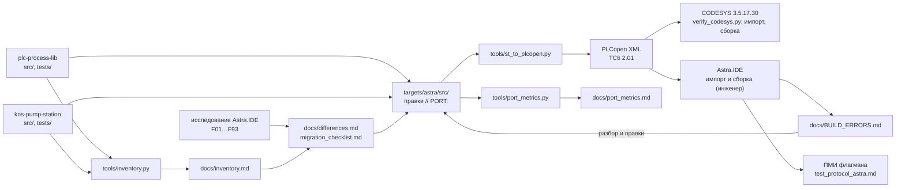

# kns-port-domestic

[](https://github.com/kr0nsch/kns-port-domestic/actions/workflows/ci.yml)

Перенос флагмана КНС-1 ([kns-pump-station](https://github.com/kr0nsch/kns-pump-station)) и
библиотеки [plc-process-lib](https://github.com/kr0nsch/plc-process-lib) из CODESYS V3.5 SP17
Patch 3 (3.5.17.30) в отечественную среду Astra.IDE (РегЛаб, ПЛК REGUL) с подсчётом цены переноса.
Здесь готовятся код и документы, а компилирует и испытывает в Astra.IDE инженер: ошибки среды
возвращаются в репозиторий через [docs/BUILD_ERRORS.md](docs/BUILD_ERRORS.md) и закрываются правками
с маркером `// PORT:`.

## Статус

**Этап 1 — инструменты и анализ (готово).** Адаптированного кода (`targets/astra/src/`) пока нет:
он появится после первой сборки в Astra.IDE, которая покажет, нужна ли замена ООП.

| Этап | Что | Состояние |
|---|---|---|
| 1. Анализ | исследование Astra.IDE: 93 факта со ссылками, риски, чек-лист «проверить вручную» → [differences.md](docs/differences.md) | готово |
| 1. Инвентаризация | `tools/inventory.py` → [inventory.md](docs/inventory.md): что из CODESYS используется в коде и где | готово |
| 1. Конвертер | `tools/st_to_plcopen.py`: раскладка → PLCopen XML; проверен импортом и сборкой в CODESYS 3.5.17.30 → [plcopen.md](docs/plcopen.md) | готово |
| 1. Метрики | `tools/port_metrics.py`: строки без изменений, изменённые, переписанные; маркеры `// PORT:` → [port_metrics.md](docs/port_metrics.md) | инструмент готов, отчёта нет (нет кода) |
| 1. Документы | [чек-лист миграции](docs/migration_checklist.md), [журнал сборки](docs/BUILD_ERRORS.md), [бланк протокола ПМИ](docs/test_protocol_astra.md) | готово |
| 2. Пробная сборка | инженер собирает в Astra.IDE XML фикстуры конструкций и библиотеки как есть (итерация 1) | ждёт инженера |
| 2. Адаптированный код | `targets/astra/src/`: правки только там, где без них нельзя, каждая с `// PORT: [категория] причина` | после итерации 1 |
| 3. Испытания | та же ПМИ флагмана в Astra.IDE (ВПЛК REGUL R500) → [test_protocol_astra.md](docs/test_protocol_astra.md) | после сборки без ошибок |

Порядок сред — решение инженера: первой — Astra.IDE (она у него установлена), MasterSCADA 4D — позже,
отдельным этапом ([ASSUMPTIONS.md](docs/ASSUMPTIONS.md#цель-и-порядок-переноса)).

## Демонстрация

> _Плейсхолдер: снимки импорта PLCopen XML и сборки в Astra.IDE появятся после первой итерации
> `BUILD_ERRORS.md` — их снимает инженер на своей установке. Проверка того же файла в CODESYS
> 3.5.17.30 — таблица в [docs/plcopen.md](docs/plcopen.md#эталонная-проверка-в-codesys-351730)._

## Архитектура



Исходники библиотеки и флагмана читаются из соседних рабочих копий и не копируются сюда до этапа 2.
Раскладка исходников — та же, что у всего портфолио ([docs/LAYOUT.md](docs/LAYOUT.md)): один объект
CODESYS — один файл или папка.

## Что переносится

| Источник | Объём (по `docs/inventory.md`) | Состояние |
|---|---|---|
| Библиотека `plc-process-lib`, ветка `integrate` (выпуск 1.0) | 115 объектов; `src` — 79 объектов, 4199 строк кода; `tests` — 36 объектов, 13876 строк кода | исходники готовы |
| Флагман КНС-1 `kns-pump-station` | собственного кода пока нет (в `src/` только пример шаблона) | пишется; инвентаризация повторяется командой |

Главные риски для Astra.IDE (счёт `src / tests`, полная таблица — в
[inventory.md](docs/inventory.md#главные-риски)):

| Риск | Возможность | Мест | Что делаем |
|---|---|---|---|
| высокий | юнит-тесты coUnit | 0 / 3622 | собрать тестовый проект с coUnit; при отказе тесты логики остаются в CODESYS 3.5.17.30, на REGUL — сценарии ПМИ |
| высокий | наследование ФБ (`EXTENDS`) | 7 / 18 | пробная сборка; при отказе — композиция и интерфейсы (`[oop]`) |
| высокий | `SUPER^` | 6 / 3 | вместе с `EXTENDS` |
| средний | `PRIVATE` / `PROTECTED` | 0 / 428, 49 / 5 | при отказе — без спецификатора, поведение то же |
| средний | `LTIME`: тип, литералы, преобразования | 37 / 19, 13 / 86, 19 / 0 | проверить компиляцией и на ВПЛК |
| средний | свойства ФБ и интерфейсов | 19 + 19 / 2 | при отказе — методы `GetX`/`SetX` |

В документации РегЛаб наследование ФБ, `SUPER^`, `ABSTRACT` и спецификаторы доступа не описаны
([differences.md](docs/differences.md#главное), F23), хотя основа среды — та же линейка CODESYS SP17.
Поэтому первым собирается код как есть: собирается — код библиотеки не меняется. Устройства, Modbus
RTU/TCP, OPC UA, задачи, HMI и рантайм настраиваются в проекте REGUL заново, по
[чек-листу миграции](docs/migration_checklist.md).

## Быстрый старт без железа

Нужен Python 3.11+ (в CI — 3.12). CODESYS и Astra.IDE не нужны.

```bash
python -m venv .venv
source .venv/bin/activate              # Windows: .venv\Scripts\activate
python -m pip install -r requirements-dev.txt
python -m pytest                       # тесты всех инструментов
```

### Инвентаризация возможностей CODESYS

Нужны соседние каталоги `../plc-process-lib` и `../kns-pump-station` (пути — в `tools/inventory.toml`,
переменные `PL_REPO`, `KNS_REPO`, ревизия библиотеки — `PL_REV`).

```bash
python tools/inventory.py                  # пересобрать docs/inventory.md и docs/inventory.json
python tools/inventory.py --check          # отчёт актуален? код 1 — устарел
python tools/inventory.py --source lib=../_wt/plc-process-lib-integrate@worktree   # рабочее дерево как есть
python tools/inventory.py --source astra=targets/astra    # добавить дерево, например адаптированный код
```

Файлы читаются из коммитов (`git archive`), коммит записывается в отчёт; объекты, побайтно совпадающие с
примером шаблона, пропускаются; счёт ведётся по разобранному тексту, комментарии и строки не учитываются
([ASSUMPTIONS.md](docs/ASSUMPTIONS.md#инвентаризация-toolsinventorypy)).

### PLCopen XML

```bash
# любая раскладка (--root — каталог с src/), с проверкой по официальной схеме TC6 2.01
python tools/st_to_plcopen.py --root ../plc-process-lib --out build/plcopen/plc-process-lib.xml --xsd auto
python tools/st_to_plcopen.py --src targets/astra/src --out build/plcopen/astra.xml --xsd auto
python tools/st_to_plcopen.py --namespace tc6_0200 ...                    # как пишет экспорт Astra.IDE
python tools/st_to_plcopen.py --reverse export.xml --to build/from-xml     # XML -> раскладка
python tools/plcopen/verify_codesys.py     # эталон: импорт и сборка в CODESYS 3.5.17.30 (Windows с CODESYS)
```

Формат, подмножество и ограничения — [docs/plcopen.md](docs/plcopen.md).

### Метрики переноса

```bash
# когда появится targets/astra/src; полная команда с метками и исключениями — в docs/port_metrics.md
python tools/port_metrics.py --strict      # код 1 — правка без маркера // PORT:
```

## Цикл BUILD_ERRORS: как инженер собирает в Astra.IDE

Полный формат — в [docs/BUILD_ERRORS.md](docs/BUILD_ERRORS.md), подготовка проекта REGUL — в разделе 1
[чек-листа](docs/migration_checklist.md#1-подготовка).

1. **Репозиторий:** PLCopen XML собран `tools/st_to_plcopen.py` и проверен импортом в CODESYS
   3.5.17.30 (`tools/plcopen/verify_codesys.py`). Для итерации 1 это фикстура конструкций
   (`--root tools/plcopen/tests/fixtures/constructs`: наследование, `SUPER^`/`THIS^`,
   `ABSTRACT`/`FINAL`, спецификаторы, свойства, наследование интерфейсов, `strict`, перечисления с
   базовым типом, `STRUCT EXTENDS`, `UNION`, `VAR_IN_OUT CONSTANT`) и библиотека как есть; дальше —
   `targets/astra/src/`.
2. **Инженер, Astra.IDE:** проект мастером Regul (R500, ЦП CU 00 071-W), в «Менеджере библиотек» —
   Standard и нужные коду библиотеки; Application → «Импорт PLCopenXML…»; затем «Очистить всё» и
   «Генерировать код».
3. **Инженер:** окно «Сообщения» → Ctrl+A, Ctrl+C → новая итерация в `BUILD_ERRORS.md`: версии
   Astra.IDE, пакета и СПО, коммит этого репозитория, сообщения как есть.
4. **Разбор:** у каждого сообщения — номер `N.k`, причина и решение: правка в `targets/astra/src/` с
   маркером `// PORT: [категория] BUILD_ERRORS N.k: причина`, ручной шаг в чек-листе, строка в
   `differences.md` или новый пункт «проверить вручную».
5. **Следующая итерация:** новый XML, `tools/port_metrics.py --strict` (правка без маркера — ошибка),
   снова шаги 2–4. Цикл закончен, когда инженер записывает в сводке `BUILD_ERRORS.md`: 0 ошибок,
   предупреждения разобраны.

## Цена переноса

| Показатель | Значение |
|---|---|
| Строки без изменений / изменённые / переписанные | появятся в [port_metrics.md](docs/port_metrics.md) с первой правкой в `targets/astra/src/` |
| Правки по категориям (`[oop]`, `[types]`, `[lib]`, `[comm]`…) | там же, по маркерам `// PORT:` |
| Итераций сборки до 0 ошибок | по сводке [BUILD_ERRORS.md](docs/BUILD_ERRORS.md#сводка) |
| Трудозатраты, ч | _впишет инженер_ |

### Что не перенеслось и почему

| Объект или функция | Почему | Чем заменено |
|---|---|---|
| _заполняется по итогам итераций_ | | |

Каждая строка дублируется в [differences.md](docs/differences.md) со ссылкой на сообщение `N.k`; удалённые
объекты видны в таблице файлов [port_metrics.md](docs/port_metrics.md) со статусом «не перенесён».

### Среда, в которой подтверждена сборка

| Компонент | Версия |
|---|---|
| Astra.IDE / пакет Regul / СПО ВПЛК или ПЛК | _впишет инженер_ (совпадение версий — риск R22) |
| Устройство | REGUL R500, ЦП CU 00 071-W (ВПЛК) — _подтвердит инженер_ |
| Коммит этого репозитория | _из сводки BUILD_ERRORS.md_ |

## Тесты и проверки

| Проверка | Где | Что |
|---|---|---|
| ruff, ruff format, mypy --strict, pytest | CI | инструменты на Python: шаблона и переноса (`tools/inventory_tests`, `tools/port_metrics_tests`, `tools/plcopen/tests`) |
| PLCopen XML | pytest; CI | эталоны XML, цикл XML → раскладка, схема TC6 2.01, разбор настоящего экспорта CODESYS |
| `st_lint --strict`, assemble, iec_checker v0.4 | CI | ST в `src/` и `tests/` (сейчас пусты — пример шаблона удалён) |
| `targets/astra/src/` | CI | `st_lint --strict` и PLCopen XML для Astra.IDE в артефакте `build-reports`; пока каталога нет — шаг пропускается |
| импорт XML в CODESYS 3.5.17.30 | Windows с CODESYS: `tools/plcopen/verify_codesys.py` | импорт в приложение и в пул POU, сверка дерева и текстов, сборка, обратный экспорт |
| сборка в Astra.IDE | инженер | [BUILD_ERRORS.md](docs/BUILD_ERRORS.md) |

**Проверено в CODESYS 3.5.17.30** (19.10.2026): фикстура всех конструкций (61 элемент дерева:
объекты, методы, свойства, аксессоры, папки) и `src/` библиотеки (`main` — 184 элемента, `integrate` —
244) импортируются в приложение и в пул POU без потерь, тексты совпадают с файлами, сборка — 0 ошибок
и 0 предупреждений, экспорт CODESYS читается обратно в ту же раскладку; оба пространства имён
(`tc6_0201`, `tc6_0200`). Файл проходит официальную схему TC6 2.01. **Импорт в Astra.IDE не проверен**
— это шаг инженера.

## Инструменты шаблона

Репозиторий создан из [plc-repo-template](https://github.com/kr0nsch/plc-repo-template): раскладка
ST, линтер, сборка для статанализа и `tools/codesys/cds.py` (импорт, сборка и тесты в CODESYS из консоли)
остаются без изменений. Ими пользуется эталонная проверка XML; описание — в
[tools/README.md](tools/README.md) и [docs/MANUAL_STEPS.md](docs/MANUAL_STEPS.md).

## Документация

- [differences.md](docs/differences.md) — различия CODESYS 3.5.17 и Astra.IDE: аспект, как у нас,
  как в Astra.IDE, решение, источник; приложение — 93 факта со ссылками на документы РегЛаб
- [inventory.md](docs/inventory.md) — какие возможности CODESYS используют библиотека и флагман, где и
  с каким риском
- [migration_checklist.md](docs/migration_checklist.md) — подготовка, типы и библиотеки, ввод-вывод,
  связь, HMI, испытания, риски, пункты «проверить вручную»
- [BUILD_ERRORS.md](docs/BUILD_ERRORS.md) — журнал сборки в Astra.IDE
- [plcopen.md](docs/plcopen.md) — конвертер PLCopen XML: формат, подмножество, ограничения, проверка в CODESYS
- [port_metrics.md](docs/port_metrics.md) — метрики переноса и методика
- [test_protocol_astra.md](docs/test_protocol_astra.md) — бланк протокола ПМИ в Astra.IDE
- [ARCHITECTURE.md](docs/ARCHITECTURE.md), [ASSUMPTIONS.md](docs/ASSUMPTIONS.md),
  [LAYOUT.md](docs/LAYOUT.md), [MANUAL_STEPS.md](docs/MANUAL_STEPS.md)

## Ограничения и дальнейшие шаги

- Сборку в Astra.IDE подтверждает только инженер: на стенде разработки Astra.IDE нет, поэтому здесь
  нигде не написано «собирается в Astra.IDE» без записи в `BUILD_ERRORS.md`.
- Факты о среде — на 16.10.2026, Astra.IDE 1.7.2.x, пакет 1.7.2.6. Где документации нет, пункт вынесен
  в «проверить вручную» (чек-лист, раздел 9).
- PLCopen XML переносит только объекты раскладки: задачи, дерево устройств, Modbus, символьная
  конфигурация OPC UA, визуализация и ссылки на библиотеки настраиваются в проекте вручную. Режим
  `--no-plaintext` (только TC6) теряет `VAR_INST`, `ABSTRACT`, а метод с `PRIVATE FINAL` CODESYS
  из такой структуры не восстанавливает ([plcopen.md](docs/plcopen.md#только-tc6---no-plaintext)).
- Флагман ещё пишется: инвентаризация и перенос его кода — после появления исходников в
  `kns-pump-station`.
- Обслуживание на REGUL (выгрузка RETAIN перед полной загрузкой и обновлением СПО, восстановление после)
  появится здесь после проверки команд `saveretain`/`restoreretain` (пункт D3 чек-листа): в руководстве
  их имена записаны по-разному.
- Дальше: итерация 1 в Astra.IDE → `targets/astra/src/` → итерации до 0 ошибок → ПМИ на ВПЛК →
  метрики и трудозатраты в README. MasterSCADA 4D — отдельным этапом после Astra.IDE.

## Summary (EN)

Port of the KNS-1 sewage pump station flagship and the plc-process-lib library from CODESYS V3.5 SP17
Patch 3 (3.5.17.30) to the Russian Astra.IDE (RegLab, REGUL PLCs), with the cost of the port measured.
Stage 1 is done: a sourced comparison of the two environments (93 vendor-documented facts), a feature
inventory of the code (`tools/inventory.py`), a layout → PLCopen XML (TC6 2.01) converter verified by
import and build in CODESYS 3.5.17.30 (`tools/st_to_plcopen.py`), port metrics based on `// PORT:`
markers (`tools/port_metrics.py`), a migration checklist and a test protocol form. The engineer
compiles in Astra.IDE and pastes the compiler messages into `docs/BUILD_ERRORS.md`; fixes go to
`targets/astra/src/`. Astra.IDE import is not verified yet. Docs are in Russian.

## Лицензия

[MIT](LICENSE) © 2026 kr0nsch
