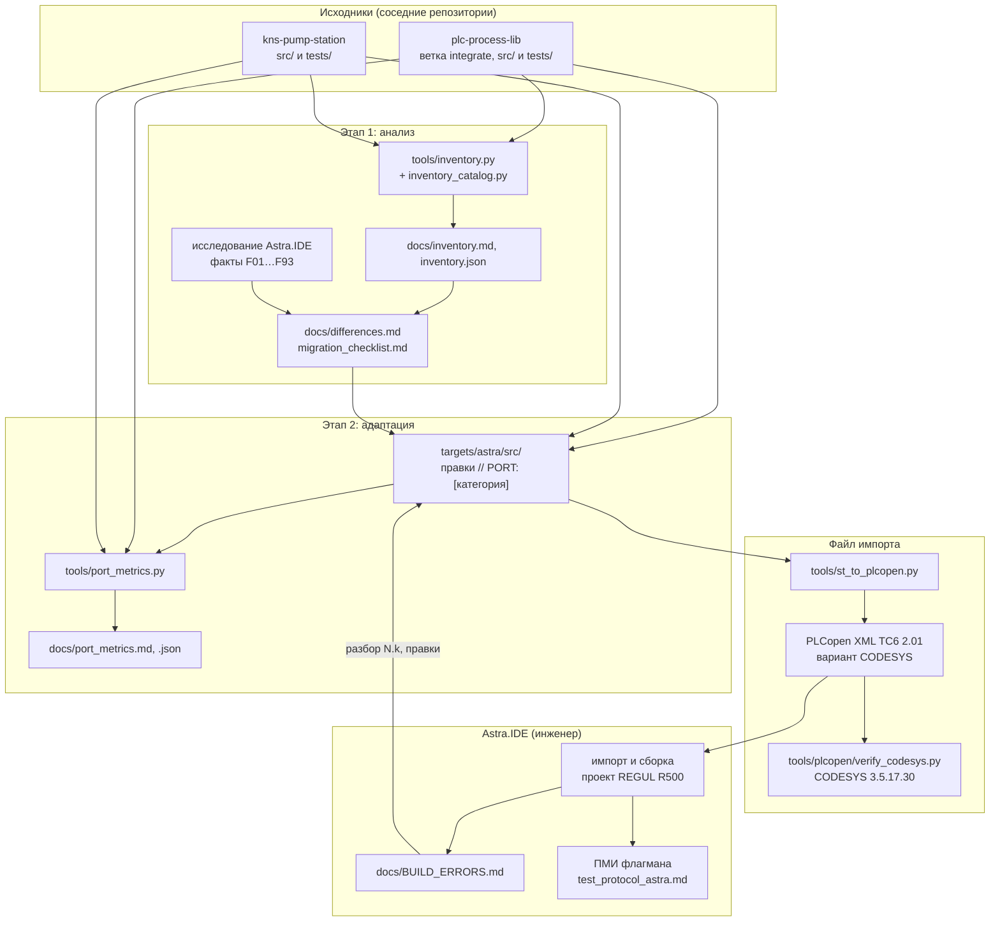

# Архитектура переноса

Репозиторий не хранит копию кода, который переносится: библиотека `plc-process-lib` и флагман
`kns-pump-station` читаются из соседних рабочих копий (git), а здесь лежат инструменты, анализ и — с
этапа 2 — адаптированный код `targets/astra/src/` в той же раскладке ([LAYOUT.md](LAYOUT.md)). Компилирует
и испытывает в Astra.IDE инженер; эталон для файлов импорта — CODESYS 3.5.17.30 на стенде разработки.

## Поток работ

## Инструменты

| Инструмент | Вход | Выход | Где работает |
|---|---|---|---|
| `tools/inventory.py` (каталог возможностей — `tools/inventory_catalog.py`, источники — `tools/inventory.toml`) | коммиты библиотеки и флагмана (`git archive`), пример шаблона как базовая линия | `docs/inventory.md`, `docs/inventory.json` | любой ПК с Python и git |
| `tools/st_to_plcopen.py` | раскладка (`src/`, `targets/astra/src/` или любая другая) | PLCopen XML; обратно — раскладка из XML | любой ПК; проверка по схеме — с `lxml` и сетью (или локальной копией схемы) |
| `tools/plcopen/verify_codesys.py` + `cds_import_check.py` (IronPython 2.7) | раскладки | импорт в приложение и в пул POU, сверка дерева и текстов, сборка, обратный экспорт — `build/plcopen/verify.md` | Windows с CODESYS 3.5.17.30 |
| `tools/port_metrics.py` | раскладки оригинала и `targets/astra/src/` | `docs/port_metrics.md`, `docs/port_metrics.json`; `--strict` — код 1 при правке без маркера | любой ПК с соседними рабочими копиями |
| инструменты шаблона (`tools/assemble.py`, `tools/check/`, `tools/codesys/`) | `src/`, `tests/` | линтер, статанализ, сборка и тесты в CODESYS | см. [tools/README.md](../tools/README.md) |

Инструменты переноса не зависят от CODESYS и Astra.IDE, кроме эталонной проверки. Разбор раскладки —
общий парсер шаблона `tools/codesys/stlayout.py` (Python 2.7 и 3), поэтому все инструменты одинаково
понимают объекты, методы, свойства и папки.

## Решения, которые определяют архитектуру

- **Вариант PLCopen XML — как у CODESYS:** структура TC6 плюс текст объявления каждого объекта
  (`interfaceasplaintext`). По исследованию Astra.IDE пишет те же расширения 3S (F46), а импорт CODESYS
  восстанавливает объявления из текста без потерь ([plcopen.md](plcopen.md)).
- **Отчёты повторяемы:** инвентаризация читает коммиты и пишет их номера; XML с одинаковыми исходниками
  совпадает побайтно (ObjectId — UUID5 от имени и папки), поэтому дифф XML между коммитами показывает
  только изменения кода.
- **Цена переноса считается по маркерам:** каждая правка в `targets/astra/src/` несёт
  `// PORT: [категория] причина`; метрики сравнивают файлы с оригиналом построчно и сводят правки по
  категориям ([port_metrics.md](port_metrics.md#методика)).
- Остальные решения и допущения — [ASSUMPTIONS.md](ASSUMPTIONS.md).

## Каталоги

| Каталог | Содержимое |
|---|---|
| `targets/astra/src/`, `targets/astra/tests/` | адаптированный код для Astra.IDE (этап 2; пока нет) |
| `src/`, `tests/` | пусты: пример шаблона удалён; раскладка нужна инструментам шаблона |
| `tools/` | инструменты переноса (`inventory.py`, `st_to_plcopen.py`, `port_metrics.py`, `plcopen/`) и шаблона (`assemble.py`, `check/`, `codesys/`) |
| `tools/inventory_tests/`, `tools/port_metrics_tests/`, `tools/plcopen/tests/` | тесты инструментов переноса с фикстурами (`plcopen/tests/fixtures/constructs` — фикстура всех конструкций, она же XML для итерации 1 в Astra.IDE) |
| `docs/` | анализ, чек-лист, журнал сборки, протокол ПМИ, метрики, отчёты |
| `build/` | артефакты (XML, отчёты проверок, проекты CODESYS), в git не хранится |
