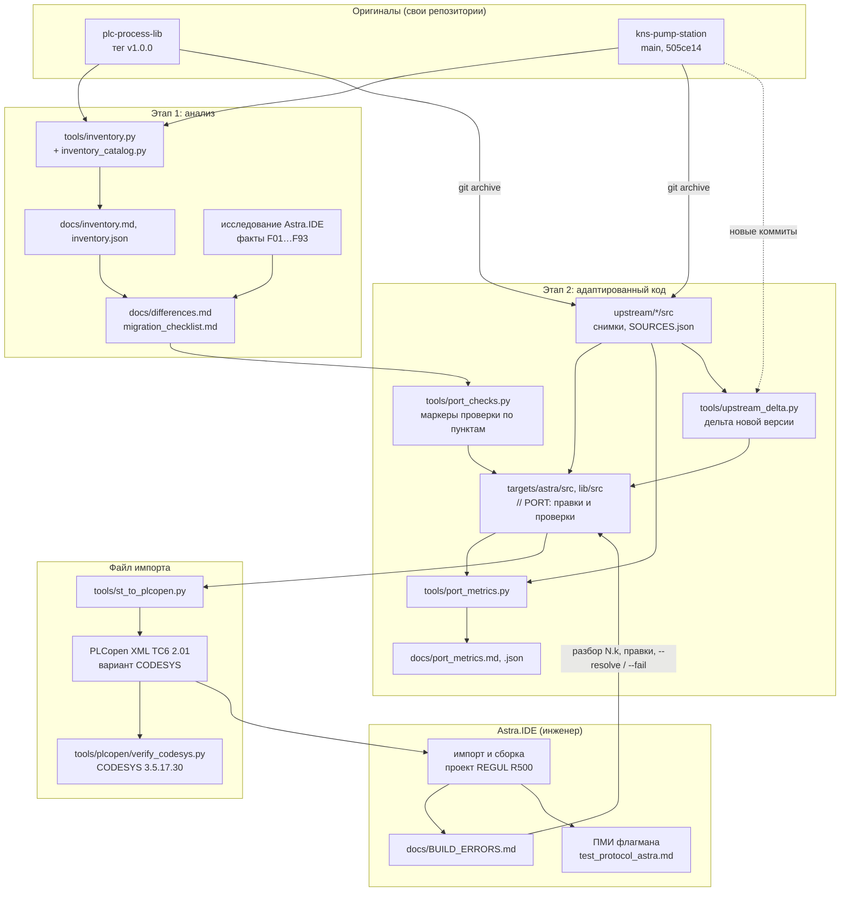

# Архитектура переноса

Репозиторий хранит снимки оригиналов на закреплённых коммитах (`upstream/`), адаптированный код для
Astra.IDE (`targets/astra/`), инструменты и анализ. Библиотека `plc-process-lib` и флагман
`kns-pump-station` живут в своих репозиториях: оттуда берутся новые версии (`tools/upstream_delta.py`)
и инвентаризация (`tools/inventory.py`). В Astra.IDE код собирается скриптом без интерфейса
(`tools/codesys/cds.py`, 19.10.2026 — 0 ошибок, [BUILD_ERRORS.md](BUILD_ERRORS.md)) или вручную; испытывает
на ВПЛК и ПЛК инженер. Эталон для файлов импорта — CODESYS 3.5.17.30 на стенде разработки.

## Поток работ

## Инструменты

| Инструмент | Вход | Выход | Где работает |
|---|---|---|---|
| `tools/inventory.py` (каталог возможностей — `tools/inventory_catalog.py`, источники — `tools/inventory.toml`) | коммиты библиотеки и флагмана (`git archive`), пример шаблона как базовая линия | `docs/inventory.md`, `docs/inventory.json` | любой ПК с Python, git и рабочими копиями оригиналов |
| `tools/port_checks.py` (решения по пунктам — `targets/astra/port_checks.json`) | раскладки `targets/astra/` или любые другие (`--tree`) | маркеры проверки у конструкций, не подтверждённых в Astra.IDE (`--fix`), сводка по пунктам чек-листа; `--resolve`, `--fail` — решения по пунктам | любой ПК с Python |
| `tools/port_metrics.py` | снимки `upstream/` и `targets/astra/` (пары по меткам) | `docs/port_metrics.md`, `docs/port_metrics.json`; `--strict` — код 1 при правке без маркера, `--check` — отчёт устарел | любой ПК с Python, в том числе CI |
| `tools/upstream_delta.py` (источники — `upstream/SOURCES.json`) | снимок, новый коммит оригинала (`git archive`), `targets/astra/` | таблица действий; `--apply` — замена, трёхстороннее слияние `git merge-file`, копирование, удаление, новый снимок; `--verify` — снимок совпадает с коммитом | любой ПК с Python, git и рабочей копией оригинала |
| `tools/st_to_plcopen.py` | раскладка (`targets/astra`, `targets/astra/lib` или любая другая) | PLCopen XML; обратно — раскладка из XML | любой ПК; проверка по схеме — с `lxml` и сетью (или локальной копией схемы) |
| `tools/plcopen/verify_codesys.py` + `cds_import_check.py` (IronPython 2.7) | раскладки | импорт в приложение и в пул POU, сверка дерева и текстов, сборка, обратный экспорт — `build/plcopen/verify.md` | Windows с CODESYS 3.5.17.30 |
| инструменты шаблона (`tools/assemble.py`, `tools/check/`, `tools/codesys/`) | раскладки `src/`, `tests/` (`st_lint` и `run_iec_checker` — и `targets/astra/`) | линтер, статанализ, сборка и тесты в CODESYS | см. [tools/README.md](../tools/README.md) |

Инструменты переноса не зависят от CODESYS и Astra.IDE, кроме эталонной проверки. Разбор раскладки —
общий парсер шаблона `tools/codesys/stlayout.py` (Python 2.7 и 3), поэтому все инструменты одинаково
понимают объекты, методы, свойства и папки.

## Решения, которые определяют архитектуру

- **Код переносится как есть, пока среда не сказала иначе:** где поведение Astra.IDE документацией не
  подтверждено, код остаётся в форме CODESYS с маркером проверки; правка появляется только по
  результату сборки или там, где без неё нельзя наверняка (связь Modbus на REGUL). Подробно —
  [ASSUMPTIONS.md](ASSUMPTIONS.md#этап-2-адаптированный-код), P9.
- **Источник закреплён коммитом и лежит снимком:** метрики считаются от снимка в CI, а снимок служит
  общим предком трёхстороннего слияния, когда флагман обновляется ([targets/astra/README.md](../targets/astra/README.md#когда-флагман-или-библиотека-обновились)).
- **Вариант PLCopen XML — как у CODESYS:** структура TC6 плюс текст объявления каждого объекта
  (`interfaceasplaintext`). По исследованию Astra.IDE пишет те же расширения 3S (F46), а импорт CODESYS
  восстанавливает объявления из текста без потерь ([plcopen.md](plcopen.md)).
- **Отчёты повторяемы:** инвентаризация читает коммиты и пишет их номера; XML с одинаковыми исходниками
  совпадает побайтно (ObjectId — UUID5 от имени и папки), поэтому дифф XML между коммитами показывает
  только изменения кода.
- **Цена переноса считается по маркерам:** каждая правка в `targets/astra/` несёт
  `// PORT: [категория] причина`, каждое непроверенное место — маркер проверки с пунктом чек-листа;
  метрики сравнивают файлы со снимком построчно и сводят правки и проверки по категориям
  ([port_metrics.md](port_metrics.md#методика)).
- Остальные решения и допущения — [ASSUMPTIONS.md](ASSUMPTIONS.md).

## Каталоги

| Каталог | Содержимое |
|---|---|
| `targets/astra/src/` | адаптированное приложение КНС-1: код флагмана и объекты сборки REGUL (`POUs/Regul`, `GVLs/Regul`) |
| `targets/astra/lib/src/` | адаптированная библиотека plc-process-lib (пространство имён `PL`) |
| `targets/astra/` | ещё `port_checks.json` (решения по пунктам), `iec_checker_allow.toml` и [README.md](../targets/astra/README.md) |
| `upstream/` | снимки `src` оригиналов на коммитах переноса и `SOURCES.json` |
| `src/`, `tests/` | пусты: пример шаблона удалён; раскладка нужна инструментам шаблона |
| `tools/` | инструменты переноса (`inventory.py`, `port_checks.py`, `port_metrics.py`, `upstream_delta.py`, `st_to_plcopen.py`, `plcopen/`) и шаблона (`assemble.py`, `check/`, `codesys/`) |
| `tools/inventory_tests/`, `tools/port_metrics_tests/`, `tools/port_tests/`, `tools/plcopen/tests/` | тесты инструментов переноса с фикстурами (`plcopen/tests/fixtures/constructs` — фикстура всех конструкций, она же XML для пробной сборки в Astra.IDE) |
| `docs/` | анализ, чек-лист, журнал сборки, протокол ПМИ, метрики, отчёты |
| `build/` | артефакты (XML, отчёты проверок, проекты CODESYS), в git не хранится |
